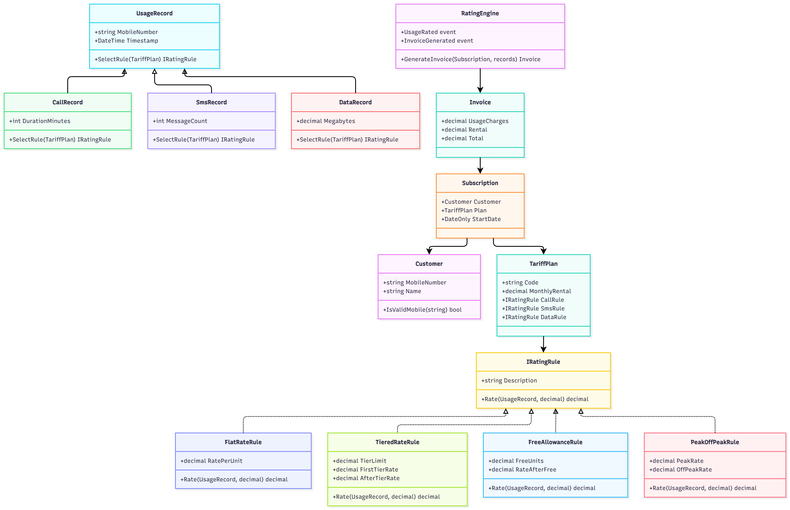

# TeleBill Rating Engine v1 (Week 2)
 
Console app that rates calls, SMS and data, and generates monthly invoices.
 
## Run
```
dotnet run
```
 
## What it does
- Domain classes with validation (Customer, TariffPlan, Subscription, Call/Sms/Data records)
- Rating rules behind `IRatingRule`: Flat, Tiered, Free Allowance, Peak/Off-peak
- Events: `UsageRated`, `InvoiceGenerated` → console logger + high-bill alert (Rs.1500)
- Seed data: 50 customers, 1,000 usage records
- 4 LINQ reports: top 5 spenders, usage by type, customers with no usage, average bill per plan
 
## Class diagram
 
 
